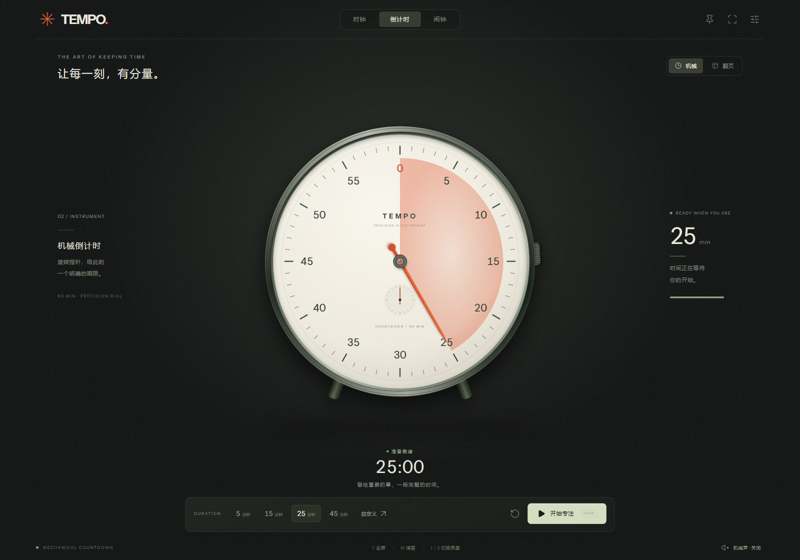
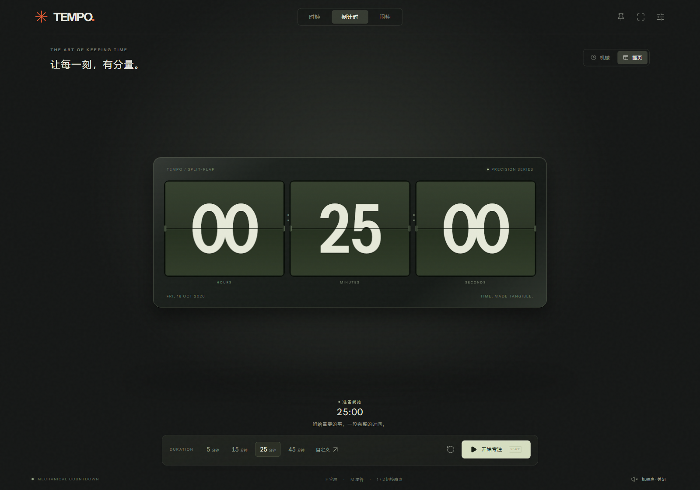

# 一刻 · TEMPO

**一刻**是中文名，**TEMPO** 是英文名。

**Time, made tangible. / 时间，有形。**

A tactile desktop clock for Windows and macOS: a mechanical dial, split-flap display, visual countdown, and a crisp, restrained mechanical voice.

**[下载 0.2 公开预览版 · Windows / Mac](https://github.com/vivian-labs/tempo/releases/tag/v0.2.0)**

TEMPO is developed openly under vivian-labs. The initial Electron prototype is preserved in `prototypes/electron` as a functional and performance baseline. The current implementation uses Tauri 2, Svelte 5, TypeScript and Rust.

当前实现支持机械指针、逐渐消失的倒计时扇区、分片翻页、每日闹钟、稍后提醒、三种程序化音色、全屏、置顶、静止后隐藏操作界面，以及墨黑 / 暖白 / 纯黑主题。数字读数可以关闭。计时与声音由 Rust 内核维护，界面按时间变化更新。

```sh
npm ci
npm run desktop
```

需要 Node 24、Rust 1.90+ 与平台构建依赖，详见 [开发说明](docs/DEVELOPMENT.md)。浏览器预览请用 `npm run dev`；它仅用于界面开发，不替代原生计时和音频。




## Product principles

- A physical instrument on screen: deliberate proportions, material depth, legible markings and convincing motion.
- Time disappears visibly; urgency rises near the deadline without arbitrary flashing or surprise sound.
- Mechanical and split-flap views share one authoritative time model.
- No account, no remote fonts, no tracking. Daily alarms require the app to remain running.
- Test on real platforms; a cross-platform source tree is not evidence of cross-platform runtime correctness.

## Development and research

- [Current plan](docs/PLAN.md)
- [Build and verification](docs/DEVELOPMENT.md)
- [FliTik / REA research](docs/research/flitik-implementation.md)
- [Materials, motion and sound](docs/research/design-system.md)
- [Verification and platform limits](docs/verification/2026-10-16.md)
- [Measured resource use](docs/benchmarks/2026-10-16.md)
- [Research index](docs/research/README.md)
- [Technology decision](docs/decisions/0001-desktop-architecture.md)
- [Development journal](docs/journal/2026-10-16.md)

FliTik is a reference product, not a source-code dependency. Proprietary binaries, extracted media and raw reverse-engineering output stay in the ignored `.local/` directory. Public research distinguishes observed facts from inference.

MIT for TEMPO code. Third-party licenses are retained with their assets.
