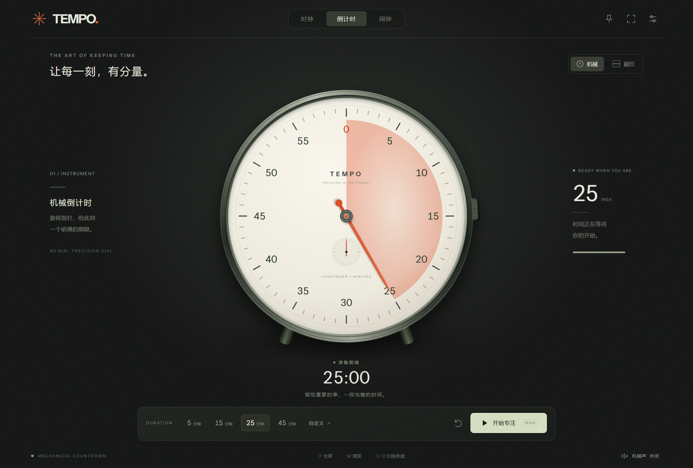

# TEMPO

时间，有形。一个离线的机械时钟、翻页时钟、倒计时和每日闹钟。



## 使用

Windows 10/11 直接打开发布文件夹中的 `TEMPO.exe`。Mac 要求 macOS 13 或更新版本，ZIP 分 Apple Silicon 和 Intel，首次运行需要本地临时签名；请先读包内说明。完整操作见 `使用说明.txt`。

特点：可拖动的模拟表盘、消退扇形、独立叶片翻折、三种原创机械音色、逐秒或连续走针、临近结束的视觉提醒、深浅背景、全屏、置顶、暂停恢复和设置保存。

闹钟要求应用保持运行；休眠和关机时不会响铃。声音默认为关，音量同时控制到时提醒。计时基于本机时间，修改系统时间会影响截止时间。

## 开发

Node.js 24.15+ 和 npm。运行：

```sh
npm ci
npm start
npm test
npm run test:desktop
npm run package:win
npm run package:mac
```

如果 npm 的安全策略跳过 Electron 的安装脚本，请执行 `node node_modules/electron/install.js` 后再启动。

项目保持小型模块：

- `app/engine.mjs`：截止时间、暂停恢复、每日闹钟及持久化数据校验。
- `app/app.mjs`：仪表渲染、翻页动画、控件和快捷键。
- `app/audio.mjs`：原创程序化机械音效。
- `main.cjs` / `preload.cjs`：Electron 桌面窗口及受限 IPC。
- `scripts/package.mjs`：下载官方 Electron 运行库并组装平台包，保留 macOS ZIP 权限及符号链接。

## 验证和参考

7 项时间引擎测试。桌面交互验证记录保存在 `docs/desktop-qa.json`，最终 Windows 包验证记录在 `docs/packaged-qa.json`。Mac 包结构验证不等于 Mac 实机运行验证。

REA 和 FliTik 的实际研究范围见 `docs/RESEARCH.md`。源码 MIT 许可；Instrument Sans 字体遵循 SIL OFL；Electron 与 Chromium 的许可随平台运行包保留。没有复制 FliTik 的专有代码或媒体资源。
